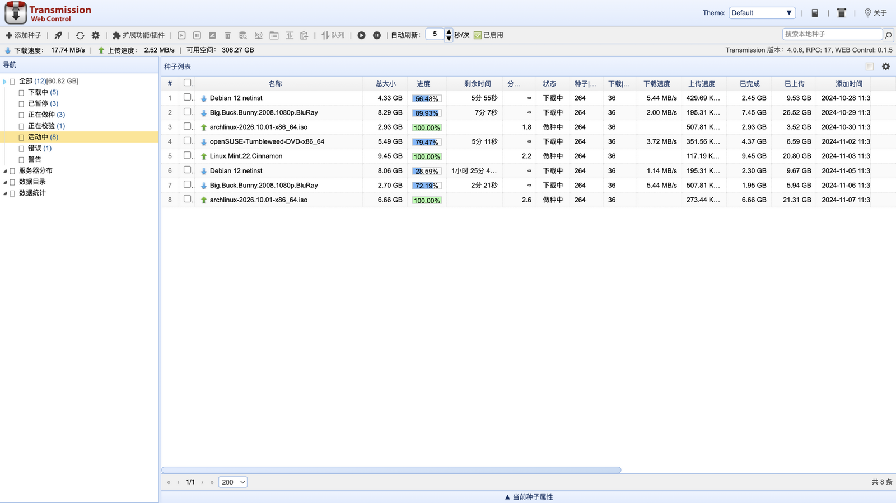
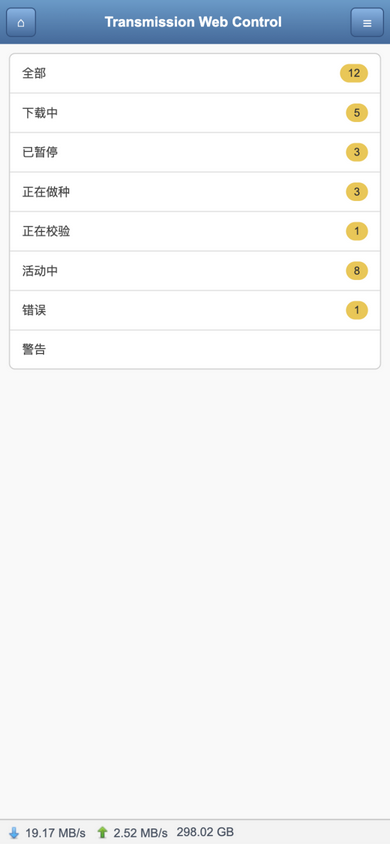
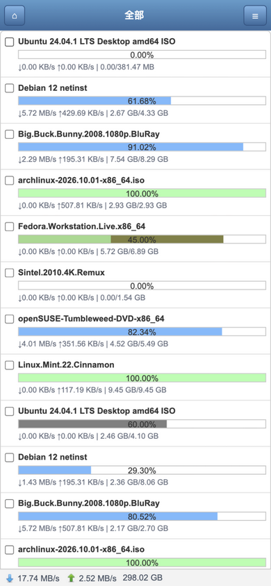

# Transmission Web Control (Next)

[](../../actions/workflows/ci.yml)
[](LICENSE)

English | [简体中文](README.md)

A modern rewrite of [ronggang/transmission-web-control](https://github.com/ronggang/transmission-web-control) — a **1:1 replica** of the original project's UI layout and interactions.

## Screenshots



| Mobile home                                      | Mobile torrent list                                          |
| ------------------------------------------------ | ------------------------------------------------------------ |
|  |  |

> Screenshots taken in development mode (`VITE_MOCK=1`) with the built-in mock data.

## Tech Stack

- **Vite + React 19 + TypeScript**
- **TanStack Query** — polling data layer (session / session-stats / torrent-get recently-active incremental sync)
- **React Router** — routing skeleton (HashRouter, so it deploys to any subdirectory)
- **Tailwind CSS v4** — styling (together with a hand-written replica layer of the EasyUI default theme)
- Hand-built EasyUI-style components: linkbutton / menu / dialog / tabs / tree / datagrid / pagination / numberspinner / switchbutton / combobox / searchbox

## Features (aligned with the original 1.6.1)

- Main layout: title bar + toolbar + status bar / left navigation tree (All, Downloading, Paused, Seeding, Verifying, Active, Error, Warning, Servers, Folders, Statistics, Labels) / torrent list / bottom torrent details panel
- Torrent list: column sorting, column resizing, right-click header to show/hide columns, multi-select (including shift range select), context menu (start/pause/rename/remove/verify/more peers/change location/queue/copy magnet link), pagination, local search
- Details panel: General (with pieces block map) / Servers & Trackers (add/edit/remove) / Files (select for download, priority, regex filter) / Peers / per-torrent options (tri-state switches)
- Dialogs: add torrent (URL/file/drag & drop), remove confirmation, rename, change download dir, speed limits, add trackers, replace trackers, server settings (basic/network/bandwidth/schedule/dir dictionary/more/labels), about
- Mobile UI: mobile devices are redirected automatically (`?devicetype=computer` forces the desktop view), replicating the original `index.mobile.html` + `system.mobile.js`
- Multiple themes: EasyUI themes (Default / Gray / Metro / Material / Bootstrap / Black plus the Metro color schemes), switchable from the title bar
- Config export / import
- i18n: zh-CN / en (language packs are the original project's JSON files), switchable under "Config → More"
- Config persistence: localStorage (same keys as the original project: `transmission-web-control.system`, `transmission-web-control`)

## Installation (as the Transmission WebUI)

Download zip/tar.gz from [Releases](../../releases), then extract `index.html` and `assets/` over Transmission's web directory (commonly `/usr/share/transmission/web/`; for Synology and other NAS devices, refer to the respective distribution), then hard-refresh the browser. RPC uses the relative path `../rpc` by default — same as the official WebUI, no extra configuration needed; you can also override it from the browser console with `localStorage.setItem('twc.rpcPath', 'https://host/rpc')`.

Deployment: the build output is static files and must be served from the same origin as the Transmission RPC (`/rpc`, `/upload`), or behind a reverse proxy mapping the same paths.

## Development

Requirements: Node.js 20.19+ / 22.12+ (required by Vite 7; CI uses Node 22).

```bash
npm install

# Connect to a local Transmission (default http://127.0.0.1:9091, override via env var)
TRANSMISSION_URL=http://127.0.0.1:9091 npm run dev

# Develop/demo against the built-in mock data without a daemon
VITE_MOCK=1 npm run dev

npm run build    # type check + production build
npm run preview  # preview the build output locally
```

Contributions are welcome — please read [CONTRIBUTING.md](CONTRIBUTING.md) first; see [CHANGELOG.md](CHANGELOG.md) for release notes.

## Release Process

Pushing a `v*` tag triggers GitHub Actions to build and publish a Release (zip / tar.gz / sha256 checksums):

```bash
npm version patch   # or minor / major
git push --follow-tags
```

## Known Differences from the Original

- GitHub update check (intentionally omitted)
- Peers flags/IP geolocation require configuring your own ipinfo.io token or a custom lookup service (Config → More)

## License

MIT (inherited from the original project, see LICENSE; icon fonts and image assets come from the original project)
