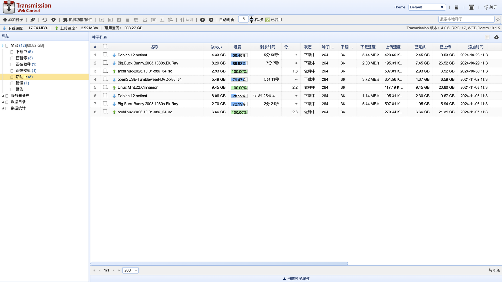
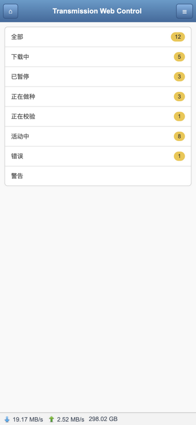
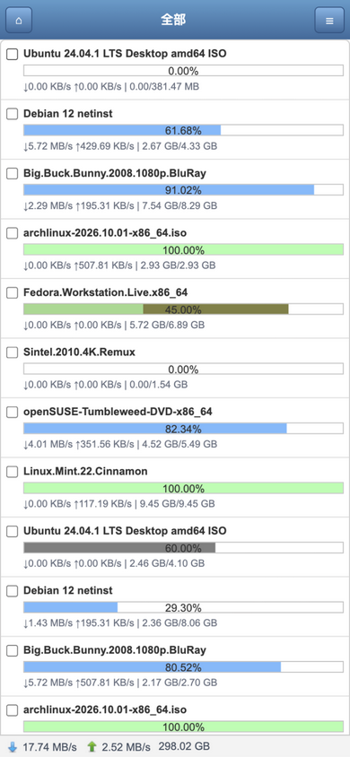

# Transmission Web Control (Next)

[](../../actions/workflows/ci.yml)
[](LICENSE)

简体中文 | [English](README.en.md)

[ronggang/transmission-web-control](https://github.com/ronggang/transmission-web-control) 的现代化重制版，**1:1 复刻**原项目的界面布局与功能交互。

## 截图



| 移动版主页                                      | 移动版种子列表                                          |
| ----------------------------------------------- | ------------------------------------------------------- |
|  |  |

> 截图来自开发模式（`VITE_MOCK=1`）下的内置模拟数据。

## 技术栈

- **Vite + React 19 + TypeScript**
- **TanStack Query** — 轮询数据层（session / session-stats / torrent-get recently-active 增量同步）
- **React Router** — 路由骨架（HashRouter，便于任意子目录部署）
- **Tailwind CSS v4** — 样式（配合手写的 EasyUI default 主题复刻层）
- 自研 EasyUI 风格组件：linkbutton / menu / dialog / tabs / tree / datagrid / pagination / numberspinner / switchbutton / combobox / searchbox

## 功能（对齐原版 1.6.1）

- 主布局：标题栏 + 工具栏 + 状态栏 / 左侧导航树（全部、下载中、已暂停、正在做种、正在校验、活动中、错误、警告、服务器分布、数据目录、数据统计、用户标签）/ 种子列表 / 底部种子属性面板
- 种子列表：列排序、列宽拖动、表头右键显隐列、多选（含 shift 连选）、右键菜单（开始/暂停/改名/删除/校验/更多Peer/改目录/队列/复制磁力链接）、分页、本地搜索
- 详情面板：常规（含 pieces 区块图）/ 服务器 Tracker（增删改）/ 文件（选下载、优先级、正则过滤）/ 用户 Peers / 单种子参数设置（三态开关）
- 对话框：添加种子（URL/文件/拖放）、删除确认、重命名、变更保存目录、上传下载限速、增加 Tracker、替换 Tracker、服务器参数设置（基本/网络/带宽/时段/目录字典/额外设置/标签）、关于
- 移动版界面：移动设备访问自动跳转（可用 `?devicetype=computer` 强制桌面版），复刻原版 `index.mobile.html` + `system.mobile.js`
- 多主题：EasyUI 多套主题（Default / Gray / Metro / Material / Bootstrap / Black 及 Metro 系列配色）标题栏一键切换
- 配置导出 / 导入
- i18n：zh-CN / en（语言包直接复用原项目 JSON），界面语言可在「参数设置-额外设置」切换
- 配置持久化：localStorage（同原项目 key：`transmission-web-control.system`、`transmission-web-control`）

## 安装（作为 Transmission WebUI）

从 [Releases](../../releases) 下载 zip/tar.gz，解压后将 `index.html` 与 `assets/` 覆盖到 Transmission 的 web 目录（常见路径 `/usr/share/transmission/web/`，群晖等 NAS 请参考对应发行版），强刷浏览器即可。RPC 默认走相对路径 `../rpc`，与官方 WebUI 一致，无需额外配置；也可在浏览器控制台通过 `localStorage.setItem('twc.rpcPath', 'https://host/rpc')` 覆盖。

部署：构建产物为静态文件，需与 Transmission RPC 同域部署（`/rpc`、`/upload`），或反代同路径。

## 开发

环境要求：Node.js 20.19+ / 22.12+（Vite 7 要求；CI 使用 Node 22）。

```bash
npm install

# 连接本机 Transmission（默认 http://127.0.0.1:9091，可通过环境变量覆盖）
TRANSMISSION_URL=http://127.0.0.1:9091 npm run dev

# 无守护进程时使用内置 Mock 数据开发/演示
VITE_MOCK=1 npm run dev

npm run build    # 类型检查 + 生产构建
npm run preview  # 本地预览构建产物
```

欢迎参与贡献，请先阅读 [CONTRIBUTING.md](CONTRIBUTING.md)；版本变更记录见 [CHANGELOG.md](CHANGELOG.md)。

## 发布流程

推送 `v*` 标签即触发 GitHub Actions 自动构建并发布 Release（zip / tar.gz / sha256 校验）：

```bash
npm version patch   # 或 minor / major
git push --follow-tags
```

## 与原版的已知差异

- GitHub 更新检查（有意省略）
- Peers 国旗/IP 归属地需自行配置 ipinfo.io token 或自定义查询服务（参数设置 → 额外设置）

## 许可

MIT（沿用原项目，见 LICENSE；图标字体与图片资源来自原项目）
